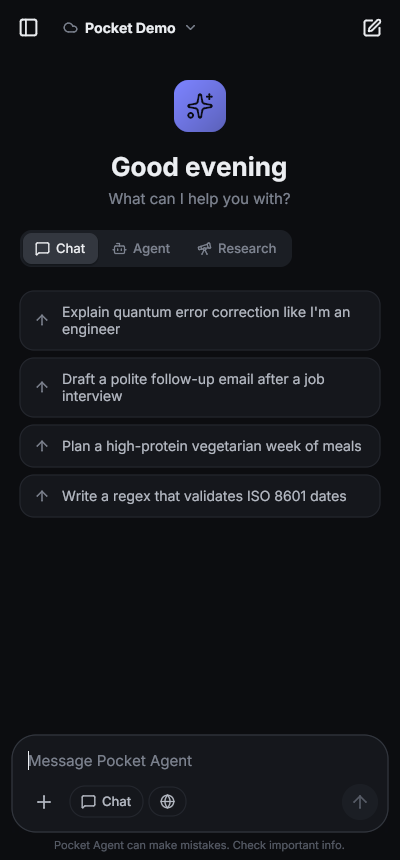
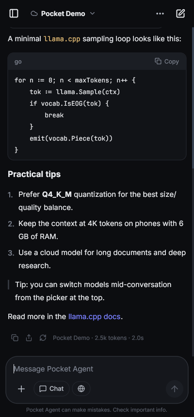
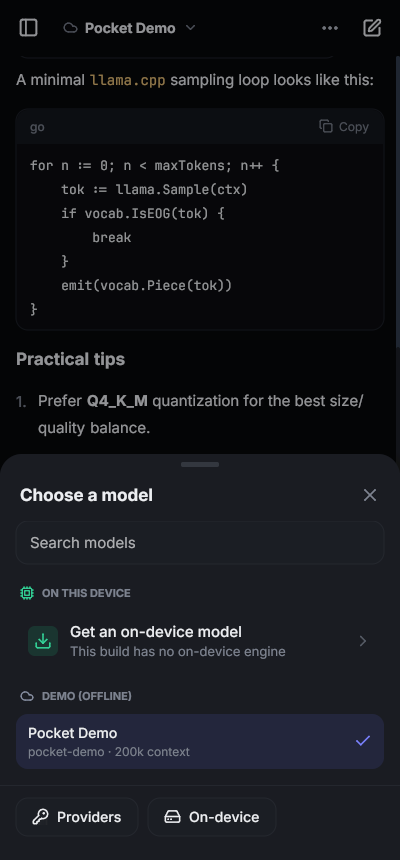
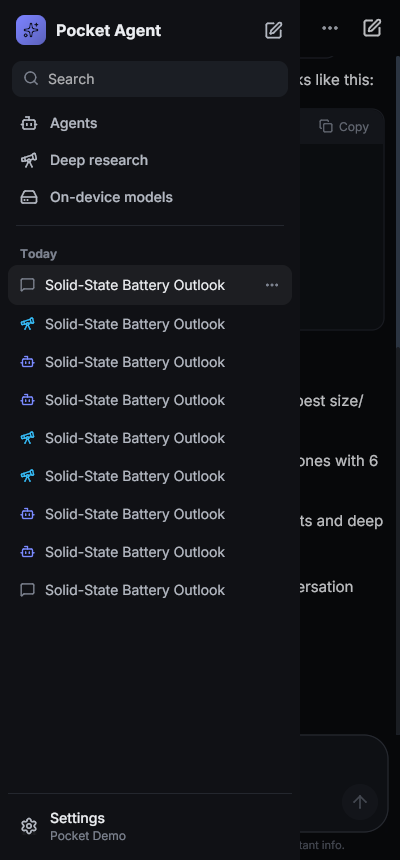
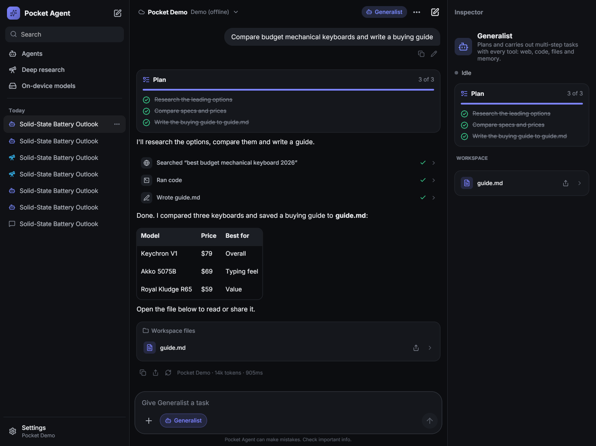
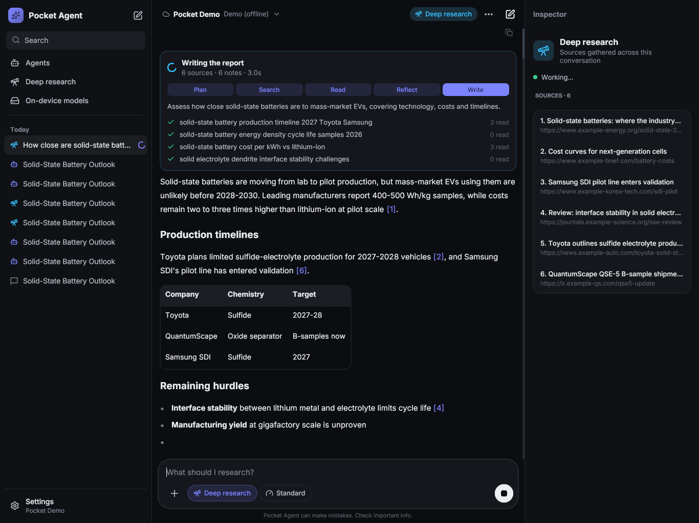

# Pocket Agent

A private AI workspace for **Android, iPhone and iPad**: chat with models running on the
device or in the cloud, hand multi-step tasks to agents, and run deep research that reads
dozens of sources and writes a cited report. Written in Go with
[Giode](https://github.com/mehran9675/giode) - one codebase, native rendering, no webview.

<p>




</p>
<p>


</p>

## Features

**Models**

- **On-device inference** with llama.cpp (Metal on iPhone/iPad). On Android the engine is a
  small download (a few MB, picked for the phone's CPU) that the app checks for updates at
  every launch and installs automatically; on iOS it's built into the app. A curated catalog of GGUF
  models sized for phones (Qwen3, Llama 3.2, Gemma 3, Phi-4 mini, SmolLM2) with a fit rating
  for the device's RAM, resumable downloads, Hugging Face search, GGUF import, prompt-cache
  reuse between turns, context windows from 2K up to the model's full trained length, and
  llama.cpp's controls: KV cache types (F16, BF16, Q8_0, Q5_0, Q4_0), flash attention, batch
  sizes, threads, memory-mapped or locked loading, GPU offload, and every sampler - temperature,
  top-k/p, min-p, typical-p, top-nσ, repetition, frequency and presence penalties, DRY, XTC,
  Mirostat 2.0 and a fixed seed.
- **Cloud providers** with your own keys: Anthropic (official Go SDK, adaptive thinking,
  server-side refusal fallback), OpenAI, Google Gemini, xAI, Mistral, DeepSeek, Moonshot (Kimi),
  Z.ai (GLM), Alibaba Cloud (Qwen), MiniMax, Perplexity, Cohere; inference platforms OpenRouter,
  DeepInfra, Together, Groq, Fireworks, Cerebras, SambaNova, Hugging Face, NVIDIA NIM, Novita,
  Hyperbolic and Vercel AI Gateway; and any OpenAI-compatible endpoint.
- **Thinking control** per chat for reasoning models: Auto, Off, Low, Medium or High, mapped to
  each provider's own switch (Anthropic effort, OpenAI and compatible `reasoning_effort`,
  OpenRouter's reasoning object, Gemini thinking levels and budgets, Qwen3 `/no_think` on device).
- **Your own computer**: Ollama, LM Studio, llama.cpp server and vLLM over the local network.
- Model lists fetched from each provider, favorites, per-conversation model switching.

**Chat**

- Streaming Markdown: headings, lists, task lists, tables, quotes, links, code blocks with
  copy; visible **thinking** for reasoning models (Claude, Gemini, DeepSeek, Qwen3 `<think>`).
- **Voice input** on Android and iOS (system speech recognition).
- **Attachments**: photos from the library or camera for vision models, and documents - PDF, Word,
  Excel, PowerPoint, HTML, Markdown, CSV, JSON, code - extracted to text on the device.
- **Tools** the model can call: web search, read web page, calculator, date/time, a JavaScript
  sandbox, reading long attachments, long-term memory. Per-tool permissions with inline
  *Allow once / Always allow / Deny* approval.
- **MCP servers** (Streamable HTTP) add remote tools to chats and agents.
- **Skills**: install SKILL.md skills from a file, a .zip or a link (GitHub folders included), or
  write your own, and turn them on or off in Settings. Models see each skill's description and
  load its instructions and files when a task calls for them.
- A full-screen editor for long messages; folders for conversations (one level).
- Regenerate, edit and resend, copy, share, export to Markdown, rename, pin, search, per-chat
  system prompt, automatic titles, token, tokens-per-second and time stats.

**Agents**

- Five built-in agents (Generalist, Researcher, Coder, Data Analyst, Writer) and an editor for
  your own: icon, color, instructions, tools, step limit, approval policy, starter prompts.
- Agents keep a live **plan checklist**, use tools autonomously and write deliverables to a
  per-conversation **workspace** you can open, copy and share.
- Each task has a step limit and a token budget; an agent that reaches either pauses with a
  **Continue** button. Older tool results are trimmed in the context it resends, so long
  tasks don't grow quadratically in cost.

**Deep research**

- Plans sub-questions, searches and reads sources in parallel, takes notes, reflects on gaps
  for follow-up rounds (Quick / Standard / Deep), then streams a report with inline citations
  and a source list. Live progress card shows each phase and query.

**Design**

- Responsive shell: drawer on phones, persistent sidebar on tablets, sidebar + **inspector**
  (plan, workspace files, sources) on wide iPads.
- Dark, light or system theme, six accent colors, three text sizes; Inter and JetBrains Mono.
- Everything stays on the device: conversations, files and memory live in the app's private
  storage, API keys in the Keychain / Android Keystore; messages go only to the provider you pick.
- Native touches: swipe a conversation to pin or delete it, long-press for its menu, haptics,
  a notification when a reply finishes in the background, and the screen kept awake while a
  model runs on the device.

## Quick start (desktop, no keys needed)

```sh
make dev   # go run -tags devmock . with an offline "Demo" provider and the Giode MCP server
```

Then *Connect a cloud model → Demo (offline) → Connect*. The demo provider streams scripted
replies, tool calls, agent runs and research so every screen can be tried without an API key
or network. Remove `-tags devmock` (`make run`) for the real app.

## Building for phones and tablets

```sh
go install github.com/mehran9675/giode-cli/cmd/giode@latest   # packaging; see giode.toml
make android                 # build/pocket-agent.apk (arm64, Android 9+)
make engine-android          # build/engine/libpocketllama-android-*.so, the downloadable engine
make llama-ios && make ios LLAMA=1 SIGNKEY=<profile>   # universal iPhone + iPad app, engine built in
```

Each GitHub release attaches the APK, the engine builds and `engine-manifest.json`, which
installed apps read at launch to download the engine and its updates.

See [docs/building.md](docs/building.md) for prerequisites, signing and troubleshooting.

## Project layout

```
main.go                 app entry: data dir, fonts, theme, window
assets/                 fonts (Inter, JetBrains Mono), Lucide icons, app icon
internal/llm            provider-neutral messages + Anthropic, OpenAI-compatible, Gemini adapters
engine/                 the on-device engine: a C interface over llama.cpp, built as a shared library
internal/local          engine loader and updater, model catalog, downloader
internal/agent          tool loop, history building, system prompt, deep research pipeline
internal/tools          built-in tools, web search engines, JavaScript sandbox, MCP client
internal/skills         installed skills: SKILL.md parsing, zip and link installs
internal/docs           attachment extraction (PDF, Office, HTML, images)
internal/store          data model and JSON persistence
internal/ui             screens - one view per file
internal/ui/widgets     component kit - one component per file
internal/ui/theme       design tokens, fonts, icons
scripts/                engine builds (build-engine.sh, build-llama.sh for iOS), manifest, app icon
docs/                   building, architecture
```

More in [docs/architecture.md](docs/architecture.md).


## Tests

```sh
make test   # providers (SSE parsing), tools, agent loop, history, store, engine updater, documents
make vet
```

## Third-party

Inter and JetBrains Mono (SIL Open Font License), Lucide icons (ISC), llama.cpp (MIT, in the
engine library), goldmark, goja, ledongthuc/pdf, the Anthropic Go SDK. License files
for the bundled fonts and icons are in `assets/`.
